# Longform Clips

> **Status: pre-alpha.** Milestone 1 is in progress. Interfaces will change.

Longform Clips turns a long video (a podcast, interview, lecture, stream VOD) into a handful of
vertical **9:16** short clips with **burned-in captions**, ready to review and post by hand.

It runs locally: speech-to-text, topic-shift detection and rendering all happen on your
machine. Nothing is uploaded and there is no hosted service.

## Pipeline

```mermaid
flowchart LR
    A[Video file or URL] --> B[ingest<br/>yt-dlp / local file]
    B --> C[transcribe<br/>faster-whisper<br/>word timestamps]
    C --> D[chunk<br/>sentences -> ~12 s chunks]
    D --> E[embed<br/>sentence-transformers]
    E --> F[boundaries<br/>cosine valleys / TextTiling depth]
    F --> G[select<br/>score 30-60 s windows<br/>snap to sentences]
    G --> H[captions<br/>ASS subtitles]
    H --> I[render<br/>FFmpeg crop 9:16, 1080x1920, burn-in]
    I --> J[preview.html / clip_N.mp4]
```



## Stack and rationale

| Stage | Choice | Why | Alternatives |
|---|---|---|---|
| Language | Python 3.11+ | Best ML ecosystem; easy for contributors | |
| Input | `yt-dlp` | De-facto standard downloader, maintained, Python API | `pytube` (unreliable), direct file only |
| STT | `faster-whisper` (CTranslate2) | Local, CPU or GPU, about 4x faster than `openai-whisper`, native word timestamps and VAD | `openai-whisper` (reference, slower); `whisper.cpp` (great on Apple Silicon / no Python); hosted APIs such as OpenAI or Groq (fast, but cost money and upload audio) |
| Embeddings | `sentence-transformers` with `all-MiniLM-L6-v2` | Small (~80 MB), fast on CPU, good topical similarity | `bge-small`, `e5-small`; OpenAI embeddings API; TF-IDF (no model, weaker) |
| Topic shifts | Cosine-similarity valleys with TextTiling depth scores (numpy) | Simple, deterministic, no training, explainable | `BERTopic`, `ruptures` change-point detection, LLM segmentation |
| Captions | ASS subtitles generated in Python | libass is built into FFmpeg and supports styling; word-level karaoke highlighting is possible later | SRT (no styling), Pillow/MoviePy overlays (slow) |
| Render | FFmpeg | Fast, ubiquitous, one command for cut + crop + scale + burn-in | MoviePy (slower, wraps FFmpeg anyway) |
| CLI | Typer | Typed, minimal boilerplate, good `--help` | argparse, click |
| Preview | Generated static `preview.html` with `<video>` elements | No server or web stack to maintain in milestone 1 | FastAPI + simple UI (possible later, local only) |

Later milestones (not in milestone 1): optional LLM hook/virality scoring, and face/speaker-aware
cropping (e.g. MediaPipe). Milestone 1 uses a **center crop**.

Heavy ML packages (`faster-whisper`, `sentence-transformers`, which pulls in PyTorch) are an
optional extra, `[ml]`. CI and unit tests do not install them and never download models.

## Install

Prerequisite: **FFmpeg** (with libass, the default in most builds) on your `PATH`.

```bash
# macOS:           brew install ffmpeg
# Debian/Ubuntu:   sudo apt install ffmpeg
# Windows:         winget install ffmpeg

git clone https://github.com/wlaust3/longform-clips && cd longform-clips
python -m venv .venv && source .venv/bin/activate
pip install -e ".[ml]"      # runtime incl. Whisper + embeddings
pip install -e ".[dev]"     # add pytest + ruff for development
longform-clips --help
```

The first `analyze` run downloads the Whisper model (`small` is about 460 MB) and the embedding
model (~80 MB).

## Usage

```bash
# 1. Find candidates (local file or URL)
longform-clips analyze my_podcast.mp4 --out out/
longform-clips analyze "https://www.youtube.com/watch?v=..." --out out/

# 2. Render low-res previews and open out/preview.html
longform-clips preview --out out/

# 3. Export your favorite as a final 1080x1920 mp4
longform-clips export --out out/ --candidate 2     # -> out/clips/clip_2.mp4
```

Useful flags: `--model tiny|base|small|medium|large-v3`, `--device cpu|cuda`,
`--embedder hash` (offline, weaker), `--transcript transcript.json` (skip STT), `--seed`.

## Roadmap

- **Milestone 1** ([docs/MILESTONE-1.md](docs/MILESTONE-1.md)): one video in, 3-5 candidate clips out, export one.
- Milestone 2: word-level caption highlighting, caption style options, batch export.
- Milestone 3: optional LLM hook/virality scoring.
- Milestone 4: face/speaker-aware cropping (MediaPipe).

Out of scope for now: hosting/deployment, accounts, billing, and posting or scheduling to social
platforms.

## Docs

- [docs/ARCHITECTURE.md](docs/ARCHITECTURE.md): stages, data formats, module interfaces
- [docs/MILESTONE-1.md](docs/MILESTONE-1.md): scope and acceptance criteria
- [docs/HANDOFF.md](docs/HANDOFF.md): notes for coding agents and contributors

## Legal

Only clip content you own or have permission to use. Downloading or re-posting other people's
videos can violate copyright law and platform Terms of Service (including YouTube's). You are
responsible for how you use this tool. It is provided as-is under the MIT license.

## License

MIT, see [LICENSE](LICENSE).
